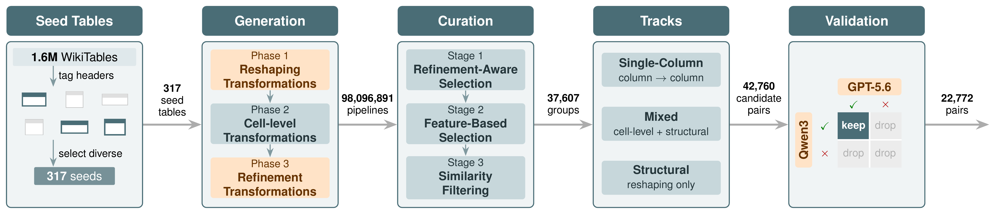

# TabTrans: A Table Transformation Benchmark for Example-Driven Systems

A benchmark of table transformations built from real [Wikipedia tables](http://websail-fe.cs.northwestern.edu/TabEL/).



## Dataset

The benchmark is in [data/Datasets/TabTrans_Benchmark.zip](data/Datasets/TabTrans_Benchmark.zip). It has 22,772 source-target table pairs in three tracks:

| Track | What changes |
|---|---|
| `single_column` | one column into one column |
| `mixed` | cell-level and structural transformations |
| `structural` | structural transformations only |

| Track | Pairs | Seed tables | Avg. pipeline length | Max. pipeline length | Source size (rows x cols) | Target size (rows x cols) |
|---|---:|---:|---:|---:|---:|---:|
| `single_column` | 3,678 | 191 | 1.6 | 5 | 11 x 1 | 11 x 1 |
| `mixed` | 19,066 | 270 | 16.3 | 40 | 12 x 8 | 11 x 19 |
| `structural` | 28 | 25 | 2.2 | 3 | 18 x 9 | 23 x 9.5 |
| **Total** | **22,772** | **288** | | | | |

Each track folder contains:

- `tables/<id>_source.csv` and `tables/<id>_target.csv`: the input and output table of one pair.
- `meta.csv`: one row per pair, with the pipeline that produced it (`pipeline`), the step counts and the transformations used.

## Stages

| Stage | What it does | Code |
|---|---|---|
| Seed Tables | tag the headers of the WikiTables and select a diverse set of seed tables | [src/Seed-Table Selection](src/Seed-Table%20Selection) |
| Transformation Set | semantic column tags and the transformations defined on them | [src/tagging](src/tagging), [src/transformations](src/transformations) |
| Generation | run Phase 1 (reshaping), Phase 2 (cell-level) and Phase 3 (refinement) transformations on every seed table | [src/pipeline](src/pipeline) |
| Curation | refinement-aware selection, feature-based selection, similarity filtering | [Refinement-Aware_step1-2](src/pipeline/Progressive-Pipeline-Curation/Refinement-Aware_step1.py), [feature-Based_step1-3](src/pipeline/Progressive-Pipeline-Curation/feature-Based_step3.py), [exact_jaccard_column_patterns.py](src/pipeline/Progressive-Pipeline-Curation/exact_jaccard_column_patterns.py) |
| Tracks | split the curated pairs into `single_column`, `mixed`, `structural` | [select_bucket_representatives.py](src/pipeline/Progressive-Pipeline-Curation/select_bucket_representatives.py) |
| Validation | keep a pair only when both LLM judges accept it | [src/pipeline/LLM-as-a-Judge](src/pipeline/LLM-as-a-Judge) |

## Repository

```
data/Datasets/TabTrans_Benchmark.zip    the benchmark
figures/overview.png                    overview figure
src/
├── Seed-Table Selection/
│   ├── step1_regex_tagging.py          tags the headers of the WikiTables with keyword rules
│   ├── step2_candidate_filter.py       keeps tables with at least 5 rows, at most 14 columns, at least 4 distinct types
│   ├── step3_transformation_selection.py   groups by (columns, distinct types) and picks one random table per group
│   └── step4_make_folders.py           writes one wiki_<id>/source.csv folder per seed table
├── tagging/
│   ├── catalog.yaml                    semantic tags with descriptions, examples, parameters
│   └── call_llm.py                     tags the columns of a table with an LLM
├── transformations/
│   ├── base.py                         base class: check() and apply()
│   ├── *.py                            cell-level transformations (date_format, unit_conversion, split_column, ...)
│   └── structural/                     pivot, unpivot, transpose, divide_mixed, drop_*, sort_rows, groupby_aggregate
├── pipeline/
│   ├── run_pipeline.py                 entry point of the generation stage
│   ├── pipeline_engine.py              runs Phase 1, 2 and 3 on one table
│   ├── structural_check_provider.py    LLM structural checks, called by the engine
│   ├── structural_planner.py           turns the check results into Phase 1 steps
│   ├── Progressive-Pipeline-Curation/  curation and track selection
│   └── LLM-as-a-Judge/
│       ├── llm_judge.py                judges each input/output pair
│       ├── prompt.txt                  judge prompt
│       └── judge_examples.jsonl        example judge replies (track, judge, score, reason)
└── Evaluation/LLM-Eval/
    ├── main.py                         evaluates LLMs on the benchmark
    ├── prompts.py                      prompts
    └── metrics.py                      metrics
```

The structural checks ask an LLM (Qwen2.5-72B on a vLLM server) whether a reshaping step makes sense for a table. `pipeline_engine.py` only calls `structural_check_provider.py`. That file caches the answers and calls the model, using two helpers:

- `llm_structural_check.py`: the Phase 1 question (pivot, unpivot, transpose) and the model call.
- `llm_groupby_check.py`: the Phase 3 question (groupby).

## Running

Generation:

The seed tables are split into arrays so they can run as parallel jobs, one `--array-id` per job.

```bash
python -m src.pipeline.run_pipeline --setup-arrays --num-arrays 8 --input-dir /path/to/dataset
python -m src.pipeline.run_pipeline --array-id 0 --num-arrays 8 --input-dir /path/to/dataset
```

Progressive Pipeline Curation:

```bash
PPC=src.pipeline.Progressive-Pipeline-Curation
python -m $PPC.Refinement-Aware_step1 --root /path/to/dataset
python -m $PPC.Refinement-Aware_step2 --root /path/to/dataset
python -m $PPC.feature-Based_step1 --root /path/to/dataset
python -m $PPC.feature-Based_step2 --root /path/to/dataset
python -m $PPC.feature-Based_step3 --root /path/to/dataset
python -m $PPC.run_export_selected_sequences --root /path/to/dataset
python -m $PPC.run_exact_jaccard_column_patterns --csv /path/to/dataset/_selection_analysis/selected_pipeline_column_patterns.csv
python -m $PPC.run_select_bucket_representatives --bucket-dir /path/to/dataset/_selection_analysis/exact_buckets_params_n3_t060
```
